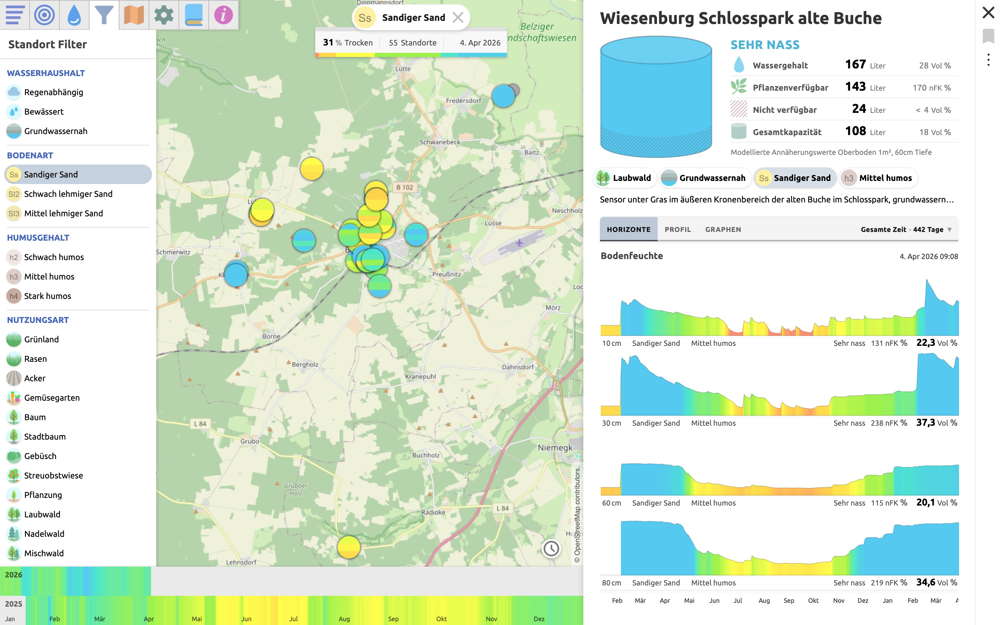

# Wasserkarte

Interaktive Datenkarte zur Visualisierung von Bodenfeuchte-Sensordaten.

Live-Version: [wasserkarte.org](https://wasserkarte.org)

## Über das Projekt

Die [Wassermeisterei](https://wassermeisterei.org) ist ein Citizen-Science-Projekt im Hohen Fläming. In der trockensten Region Deutschlands stellen Bürger*innen Bodenfeuchte-Sensoren auf und sammeln Daten, um Böden besser zu verstehen und Strategien für eine dürre-resiliente Landschaft zu entwickeln. Diese Datenkarte dient der Visualisierung der gesammelten Bodenfeuchte-Sensordaten.

Die Umsetzung erfolgt in Zusammenarbeit zwischen dem Verein Lebendiger Lernort Arensnest und dem Smart-City-Modellprojekt der Stadt Bad Belzig [Zukunftsschusterei](https://zukunftsschusterei.de/).

Projektleitung Wassermeisterei: Daniel Diehl  
Projektleitung Zukunftsschusterei: Malte Specht   
Design und Programmierung Wasserkarte: [Nikolaus Baumgarten](https://nikkki.net)  

<a href="https://zukunftsschusterei.de">
  
</a>

## Voraussetzungen

Das Projekt setzt eine laufende ThingsBoard-Instanz mit angebundenen Bodenfeuchte-Sensoren voraus. Erwartet werden Bodenfeuchte-Messungen in den Tiefen 10cm, 30cm, 60cm, 80cm. Zusätzlich werden Standortattribute für Bodenart, Humusgehalt, Bewässerung und Grundwassereinfluss erwartet.

Die ThingsBoard-seitigen Anpassungen sind in diesem [Repository](https://gitlab.opencode.de/bad-belzig/thingsboard-ce-klimadaten-mandanten-wasserkarte) hinterlegt. 

Tutorials zur Sensorinstallation, Bodenbestimmung u.v.m. auf der [Wasserwissen](https://wassermeisterei.org/wasserwissen) Seite der Wassermeisterei.

## Screenshot



## Setup

Das Projekt besteht aus einem Vue-Frontend und einem PHP API-Cache, der Daten aus ThingsBoard lädt, aufbereitet und cached.

Für die lokale Entwicklung werden benötigt:

- Localhost-Webserver mit PHP 8+
- Node.js 18+
- npm

Für den Betrieb der Anwendung reicht ein Webserver mit PHP. `Node.js` und `npm` werden nur für lokale Entwicklung und Build-Prozesse benötigt.

```bash
npm install
cp api/config-sample.php api/config.php
mkdir -p api/cache
```

In `api/config.php` mindestens setzen:

- `THINGSBOARD_URL`
- `USERNAME`
- `PASSWORD`
- `REFRESH_SECRET`

`api/cache/` und `api/storage/` müssen für PHP beschreibbar sein. `api/storage/`
enthält dauerhafte Nutzerdaten und darf beim Leeren des Caches nicht entfernt werden.

Für lokale Post-Tests in `api/config.php` `POSTS_LOCAL_MODE` auf `true` setzen.
Neue Posts erhalten dann `environment: "local"`; lokal werden auch Produktionsposts
angezeigt, sind aber lokal nur lesbar. In Produktion bleibt die Option `false` (Standard bei fehlender Option):
lokale Posts werden im Frontend ausgeblendet und können nicht bearbeitet oder gelöscht werden.
Produktionsposts haben keine Umgebungskennung. Bearbeiten erhält die bestehende
Kennzeichnung. Der Post-Cache enthält beide Umgebungen und kann mit `pulldata`
direkt lokal verwendet werden. Nur alte Caches ohne erhaltene Umgebungskennung
werden beim nächsten Zugriff einmalig aus ThingsBoard neu aufgebaut.

Der API-Cache nutzt `curl` für Requests an ThingsBoard und `zlib` zum komprimieren der Cache-Dateien.

Der Dev-Server erwartet lokal diese Struktur:

```text
http://localhost/wasserkarte/
http://localhost/wasserkarte/api/
```

`vite.config.js` proxyt `/api` standardmäßig an `http://localhost/wasserkarte/api/`. Das sollte in der Entwicklung aktiv bleiben, weil Vite PHP-Dateien nicht ausführt.

Vor dem ersten Start die Cache-Dateien erzeugen:

```bash
php api/telemetry/lasttelemetry.php
php api/telemetry/dailyaverages.php
```

Folgende Cronjobs sind für den laufenden Betrieb notwendig. Ohne sie werden die Cache-Dateien nicht aktuell erzeugt. Die Anwendung stellt standartmäßig nur durch diese Skripte aufbereitete Daten dar.

```cron
0 */2 * * * /usr/bin/php /pfad/zum/projekt/api/telemetry/lasttelemetry.php >> $HOME/wasserkarte.log 2>&1
5 0 * * * /usr/bin/php /pfad/zum/projekt/api/daily.php >> $HOME/wasserkarte.log 2>&1
```

`api/telemetry/lasttelemetry.php` aktualisiert Gerätedaten und letzte Messwerte, sollte alle zwei Stunden ausgeführt werden.

`api/daily.php` läuft täglich nach Mitternacht: zuerst Tagesmittelwerte über
`api/telemetry/dailyaverages.php`, anschließend vollständiger Neuaufbau von
`api/cache/posts.json` aus ThingsBoard. Der Posts-Cache wird auch neu aufgebaut,
wenn die Tagesmittelwerte für den Tag schon aktuell waren. Die lokale/produktive
Post-Filterung richtet sich weiterhin nach `POSTS_LOCAL_MODE` in `api/config.php`.
Das Skript ist nur über PHP CLI ausführbar, verhindert parallele Daily-Läufe per
Dateilock und meldet Fehler mit Exit-Code 1. Bestehende Cronjobs für
`dailyaverages.php` durch diesen gemeinsamen Einstieg ersetzen.

Zwischen Tagesmittelberechnung und Posts-Cache versendet `api/daily.php` die
aktivierten E-Mail-Benachrichtigungen. Über `/users/info` und die einzelnen
Profile unter `/user/{id}` werden seitenweise
Tenant-Admins und Nutzer des konfigurierten Wasserkarte-Customers berücksichtigt.
Das Account-Attribut `wasserkarte_email_settings` enthält Aktivierung, Standorte
und den gemeinsamen Grenzwert. Verwendet werden ausschließlich die Vortagswerte;
fehlende Werte bleiben neutral und lösen keine Grenzwertwarnung aus. „Immer“
enthält alle ausgewählten Standorte, auch solche ohne Messwerte.

Für Benachrichtigungen sind ein gültiger `MAIL_FROM` und ein funktionsfähiger
PHP-`mail()`-Transport nötig. `MAIL_ENABLED` steuert ausschließlich Aktivierungs-/
Zugangsmails und blockiert keine Benachrichtigungen oder Testmails. Das gilt auch auf localhost:
ein vorhandenes `sendmail` allein bestätigt noch keine Zustellung. Der Button
„Test-E-Mail senden“ schickt die aktuelle Fensterauswahl ausschließlich an den
angemeldeten Account, auch bei deaktiviertem Abonnement. Er speichert die Auswahl
nicht und ist auf einen Versuch pro Minute begrenzt. Der Test prüft dieselbe
Empfängerliste und den Einstellungsabruf wie der Cronjob; ThingsBoard-Fehler
erscheinen mit Anfragepfad, HTTP-Status und Fehlermeldung im Fenster. Ohne passende Vortagswerte
enthält die Testmail einen entsprechenden Hinweis.

Das dauerhafte Verzeichnis `NOTIFICATION_STORAGE_DIR` (Standard:
`api/storage/notifications`) darf nicht mit dem Cache gelöscht werden. Es enthält
keine Mailadressen und verhindert erneuten Tagesversand nach erfolgreicher
Übergabe an den Mailserver. Bei Prozessabbruch während der Übergabe bleibt der
Status `sending`: erst Mailserver-Logs prüfen, bevor der zugehörige Protokolleintrag
zurückgesetzt wird. Einzelne Versandfehler verhindern keine anderen Empfänger;
der Cronjob meldet sie mit Exit-Code 1. Lokal keinen Produktions-Cronjob starten.

Posts-Cache manuell vollständig neu aufbauen:

```bash
php api/posts/refresh.php
```

Alternativ per HTTP: `/api/posts/refresh.php?secret=<REFRESH_SECRET>`.
Der HTTP-Aufruf ist mit der bestehenden Refresh-Sperre geschützt und erfordert
immer das konfigurierte Geheimnis. Bei Fehlern bleibt der vorherige Posts-Cache
erhalten. Beide Varianten verwenden die Post-Filterung der jeweiligen Umgebung.

## Haftungsausschluss

Dieses Projekt wird als Open-Source-Software veröffentlicht. Die Bereitstellung erfolgt ohne Gewährleistung oder Zusicherung irgendeiner Art, soweit gesetzlich zulässig.

Insbesondere wird keine Gewähr für Funktionsfähigkeit, Eignung für einen bestimmten Zweck, Fehlerfreiheit, Kompatibilität, Verfügbarkeit oder Sicherheit übernommen. Die Nutzung, Einbindung, Veränderung und Weiterverbreitung der Software erfolgt auf eigene Verantwortung.

Soweit gesetzlich zulässig, wird keine Haftung für direkte oder indirekte Schäden, Datenverluste, Ausfälle oder sonstige Folgen übernommen, die aus der Nutzung der Software oder der Unmöglichkeit ihrer Nutzung entstehen.

## Lizenz

Copyright 2026 Nikolaus Baumgarten

GNU General Public License, Version 3 or later (`GPL-3.0-or-later`). Details in [`LICENSE`](./LICENSE).

Lizenzinformationen zu verwendeten Bibliotheken liegen unter public/lizenzen/lizenzen.txt.

Hinweis: Die GPL gewährt keine Markenrechte. Namen, Logos, Förderkennzeichen und sonstige geschützte Kennzeichen sollten vor einer öffentlichen Veröffentlichung separat geprüft werden.
